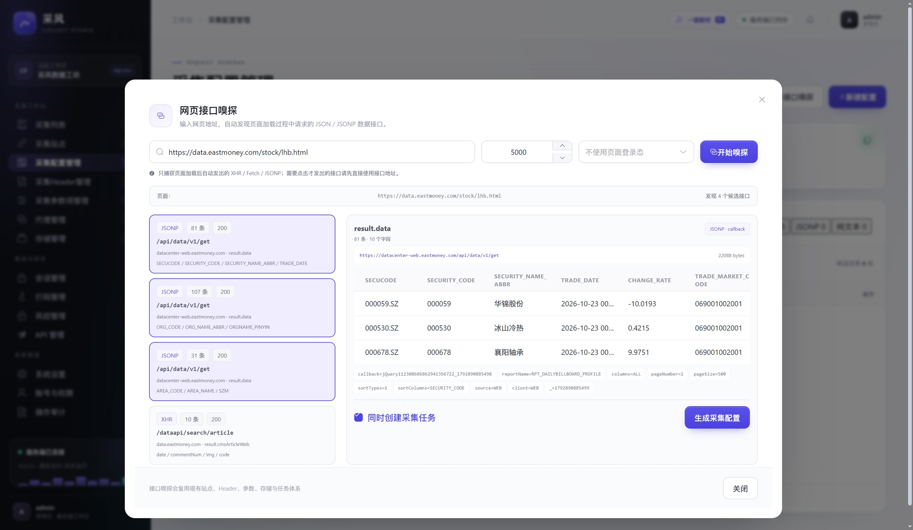
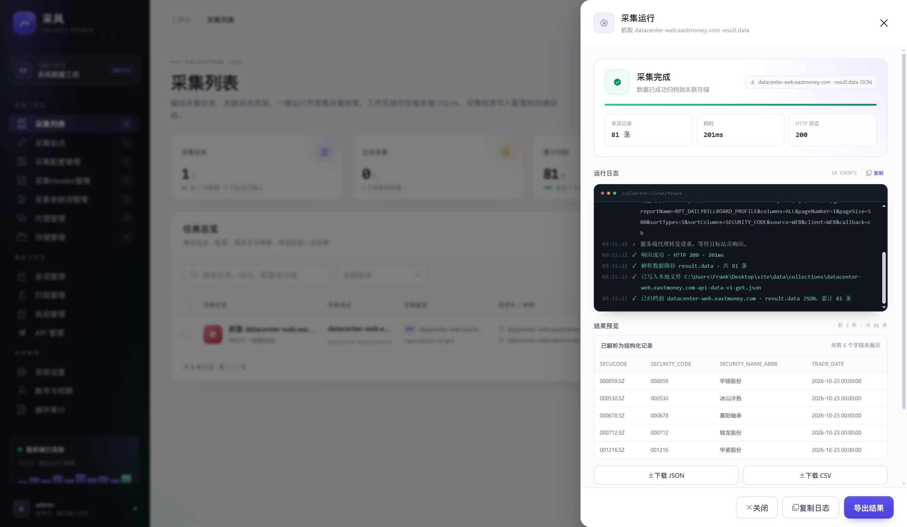
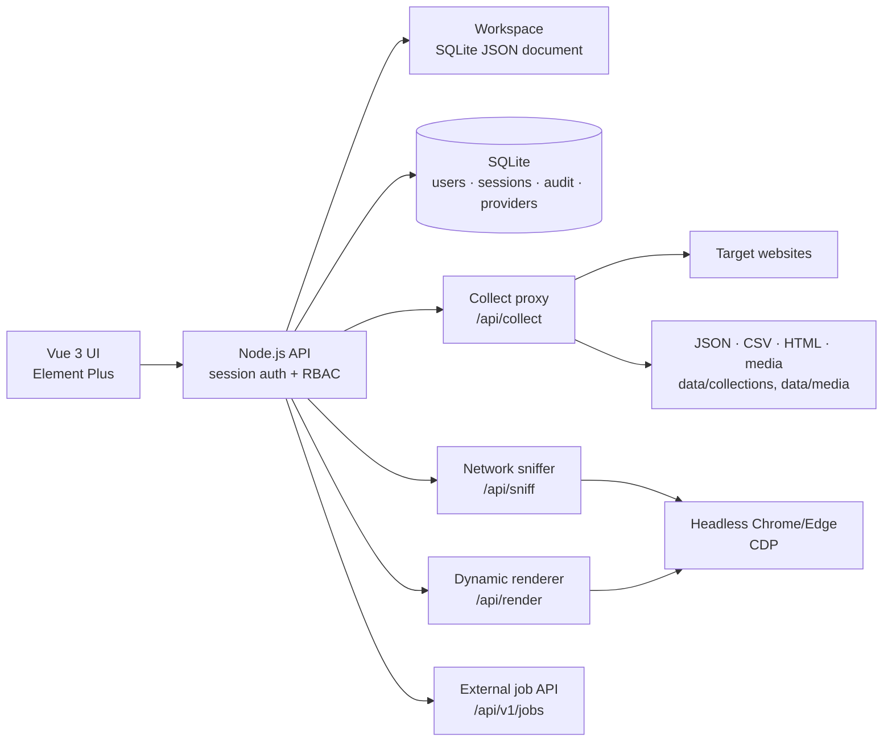

<div align="center">

# Collect Studio

### Turn authorized web pages into repeatable data pipelines.

A self-hosted visual scraping workbench for people who are tired of rewriting a new Python script for every website.

**Vue 3 + Vite + Element Plus · Node.js + SQLite · Headless Chrome · XHR / JSONP**

[Quick Start](#quick-start) · [Features](#whats-inside) · [API Sniffer](#api-sniffer) · [Architecture](#architecture) · [中文文档](README_CN.md)

<br />


<br />



<sub>Real UI: API Sniffer found three JSONP endpoints and one XHR endpoint, then generated a ready-to-run collection pipeline.</sub>

</div>

---

## Why Collect Studio?

Most scraping projects start as a single script and slowly turn into an unmaintainable pile of selectors, cookies, retries and cron jobs.

Collect Studio treats scraping as an **operations problem**, not a scripting problem:

- 🧩 **Reusable building blocks** — sites, headers, params, storages, configs and tasks are separate, composable resources.
- 🕵️ **Built-in API sniffer** — point it at a page and it finds the XHR / Fetch / **JSONP** endpoints behind the UI.
- 🪜 **Multi-level crawling** — list page → detail page → optional third level, with field merging and concurrency.
- 🧠 **AI-assisted cURL import** — paste a cURL command, get a complete site + config + task.
- 🌐 **Real browser rendering** — local Chrome/Edge via CDP for JS-heavy pages and anti-bot challenges.
- 🔐 **Production-minded foundation** — login, roles, audit logs, encrypted secrets, site sessions and API access.
- 📦 **One workspace, many outputs** — JSON, CSV, HTML snapshots, image/video folders and database connection profiles.

No cloud account. No vendor lock-in. Everything runs on your machine or your own server.

---

<a id="api-sniffer"></a>

## ⚡ API Sniffer — the feature most scrapers forget

Many data-heavy sites do **not** use plain XHR. They load data through JSONP:

```js
jQuery1123040695853331071363_1792890013613({
  "result": {
    "data": [
      { "SECURITY_CODE": "000001", "SECURITY_NAME_ABBR": "Ping An Bank" }
    ]
  }
})
```

In DevTools this looks like:

```text
Type: script
Initiator: jquery_min.js
URL: /api/data/v1/get?callback=jQuery...&reportName=...
```

A normal XHR collector sees nothing.

Collect Studio can open a page, capture **XHR, Fetch and Script** responses, unwrap JSONP, detect array paths such as `result.data` or `data.diff`, preview the records, and generate the whole pipeline:

```text
Page URL
  → headless browser
  → capture network responses
  → unwrap JSONP
  → detect record arrays and fields
  → generate site + header + params + config + storage + task
  → run and store
```

### Example

Input:

```text
https://data.eastmoney.com/stock/lhb.html
```

Detected:

| Type | Endpoint | Data path | Records |
| --- | --- | --- | --- |
| JSONP | `/api/data/v1/get` | `result.data` | 81 |
| JSONP | `/api/data/v1/get` | `result.data` | 107 |
| JSONP | `/api/data/v1/get` | `result.data` | 31 |
| XHR | `/dataapi/search/article` | `result.cmsArticleWeb` | 10 |

One click later you have a config and a task. No selector archaeology required.

<br />



<sub>JSONP collected directly, parsed, previewed and written to storage — 81 records, HTTP 200.</sub>

---

## What's inside

| Area | Capabilities |
| --- | --- |
| **Collection** | JSON, HTML pages, page fragments, images, videos, links, XHR APIs, JSONP APIs, plain text |
| **Page rules** | CSS item selectors, field mapping, page-number pagination, next-link pagination, multi-level detail crawling |
| **Multi-level crawl** | Up to 3 levels, prefixed child fields (`detail_`, `detail_2_`), concurrency, max items, skip failed detail pages, per-level JS rendering |
| **Dynamic pages** | Headless Chrome/Edge via raw CDP; wait for JS, capture XHR/Fetch responses, extract rendered links |
| **API discovery** | Network sniffer for XHR / Fetch / Script; JSONP unwrapping; automatic data-path detection; one-click config generation |
| **Import** | cURL parser, URL parser, AI-assisted parser (bring your own model), import previews and module selection |
| **Operations** | Retry, timeout, concurrency, header rotation, auto schedules, task iteration, run traces |
| **Identity** | Session login, `admin` / `operator` / `viewer` roles, audit logs, account management |
| **Target sessions** | Cookie, Bearer token and Playwright storage-state sessions, encrypted at rest |
| **Captcha** | Custom third-party captcha provider config, submit/poll jobs, job history |
| **Risk control** | Custom resolver API, browser challenge handling, manual cookies, per-task cookie injection |
| **External API** | Pull jobs, push webhooks, API clients with scopes/IP allowlist/rate limit, result callback |
| **Storage** | JSON, CSV, HTML file, image folder, video folder, HTML snapshot folder, DB connection profiles |
| **UI** | Light/dark/system theme, accent colors, density, Chinese/English UI, responsive admin layout |

---

## Quick Start

### Requirements

- **Node.js >= 22.5** — the server uses the built-in `node:sqlite`
- npm
- Chrome or Edge *(optional, for dynamic rendering and network sniffing)*

### Run locally

```bash
git clone <your-repo-url> collect-studio
cd collect-studio
npm install
cp .env.example .env
npm run dev
```

Open the URL printed by Vite, usually:

```text
http://127.0.0.1:5173
```

On first start an admin account is created:

- Username: `ADMIN_USERNAME` (default `admin`)
- Password: `ADMIN_PASSWORD`, or a random password printed in the server console

> Set `ADMIN_PASSWORD` explicitly and change it after the first login.

### Production

```bash
npm run build
npm start
```

`npm start` serves both the built frontend and `/api/*` from one Node process (default `http://127.0.0.1:8787`).

---

## 60-second tour

1. **Create a site** — base URL plus an optional page rule.
2. **Create a config** — request path, response type, data path and pagination.
3. **Create a storage** — where records should land.
4. **Create a task** — bind site + config + headers + params + storage.
5. **Run it** — watch the live trace, preview records, download JSON/CSV.

Or skip steps 1–4:

- Paste a **cURL** command into **One-click Import**.
- Paste a **page URL** into **API Sniffer** and pick a detected endpoint.

---

## Architecture



### Project structure

```text
collect-studio/
├─ src/                 Vue 3 application
│  ├─ components/       dialogs, tables, import + sniff UI
│  ├─ views/            collection, sites, configs, storages, settings...
│  ├─ utils/            collectors, parsers, schedulers, JSONP
│  ├─ services/         API client, auth, preferences
│  └─ i18n/             zh-CN / en runtime dictionary
├─ server/              Node.js API, SQLite, CDP, proxies
├─ public/              static assets
├─ data/                SQLite DB + collected files (gitignored)
└─ dist/                production build
```

---

## Configuration

| Variable | Default | Description |
| --- | --- | --- |
| `PORT` | `8787` | Production server port |
| `HOST` | `127.0.0.1` | Bind address |
| `ADMIN_USERNAME` | `admin` | Bootstrap admin username |
| `ADMIN_PASSWORD` | random | Bootstrap admin password |
| `APP_ENCRYPTION_KEY` | auto-generated | 32-byte hex/base64 key for cookies, tokens and captcha keys |
| `COOKIE_SECURE` | off | Set `1` behind HTTPS |
| `SESSION_DAYS` | `7` | Maximum login session lifetime |
| `SESSION_IDLE_HOURS` | `24` | Idle timeout |
| `CHROME_PATH` | auto-detect | Chrome/Edge executable for dynamic collection |
| `DB_PATH` | `data/app.db` | SQLite path, useful for test or mounted databases |

The app master key lives at `data/.app-key` unless `APP_ENCRYPTION_KEY` is provided.

---

## Security notes

- Put the app behind HTTPS and a reverse proxy before exposing it publicly.
- `APP_ENCRYPTION_KEY` is required to decrypt stored cookies, tokens and captcha keys. Losing it means losing those secrets.
- API keys are hashed; they are shown only once when created or reset.
- `secrets:read` is a sensitive scope — grant it only to trusted external scrapers.
- The collect proxy should remain private; do not expose `/api/collect` directly to the internet.
- Captcha, risk-control and anti-bot features are intended **only for sites you own or are authorized to collect from**. Respect terms of service and local law.

---

## Known limits

- Multi-level crawling supports up to 3 levels; detail-level pagination is not exposed in the UI yet.
- List-page pagination is capped at 10 pages; fragment/media/link pagination is capped at 50 pages.
- Auto schedules run in the browser while the app is open.
- Dynamic collection starts one headless browser per run and is slower than direct requests.
- Dynamic XHR capture sees requests fired after page load; click-triggered requests are not automated yet.
- Target proxies are saved as profiles but are not yet used for server-side egress.
- Captcha provider matching and automatic injection into collection are not wired yet.
- Database storage currently stores connection profiles; MySQL/PostgreSQL write adapters are not implemented.
- The English UI covers the shell, navigation, common labels and settings; some dynamic business text remains Chinese.
- API push webhooks are single-shot; there is no retry queue yet.

---

## Roadmap

- [ ] Click / scroll triggers for API sniffing and dynamic XHR capture
- [ ] Detail-level pagination for multi-level crawling
- [ ] Server-side proxy egress
- [ ] Captcha auto-detection and automatic solver injection
- [ ] MySQL / PostgreSQL storage adapters
- [ ] Webhook retry queue with backoff
- [ ] More English translation coverage
- [ ] Docker Compose deployment recipe

---

## Contributing

Issues, ideas and pull requests are welcome.

If you add a new collector, parser, storage backend or integration, keep the existing separation:

```text
UI → API → workspace / SQLite → collector → storage
```

Small, focused PRs are easiest to review.

---

## ⭐ If this saves you time

Building a reliable scraping workflow is mostly boring plumbing: retries, cookies, selectors, pagination, schedules, logs and storage.

If Collect Studio saves you from writing that plumbing again, **give it a star** — it helps other people find the project.

<br />

<div align="center">

**Collect less chaos. Ship more data.**

[Back to top](#collect-studio) · [中文文档](README_CN.md)

</div>
