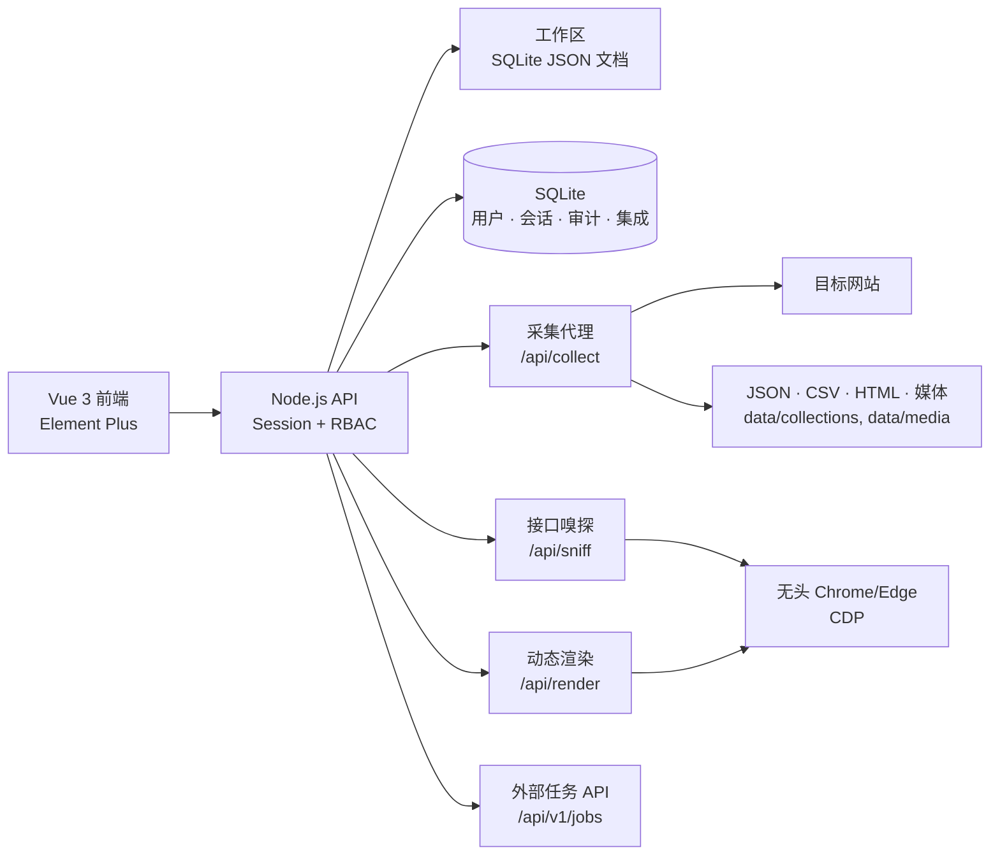

<div align="center">

# 采风 · Collect Studio

### 把已授权的网页，变成可重复执行的数据管道。

一个自托管的可视化采集工作台。不用再为每个网站重写一套 Python 脚本。

**Vue 3 + Vite + Element Plus · Node.js + SQLite · 无头 Chrome · XHR / JSONP**

[快速开始](#quick-start-cn) · [功能](#features-cn) · [接口嗅探](#api-sniffer-cn) · [架构](#architecture-cn) · [English](README.md)

<br />


<br />


<sub>真实界面：接口嗅探发现 3 个 JSONP 接口和 1 个 XHR 接口，并一键生成可执行采集配置。</sub>

</div>

---

## 为什么值得 Star？

大多数采集项目都是从一段脚本开始的。后来它慢慢变成：

```text
一堆选择器 + 一堆 Cookie + 一堆重试 + 一堆定时任务
```

采风把采集当成一个 **工程系统**，而不是一次性脚本：

- 🧩 **可复用资源**：站点、Header、参数、存储、配置、任务彼此解耦，可以组合复用。
- 🕵️ **接口嗅探**：输入网页地址，自动发现页面背后的 XHR、Fetch 和 **JSONP** 接口。
- 🪜 **多级页面采集**：列表页 → 详情页 → 可选第三级，支持字段合并和并发。
- 🧠 **AI 辅助 cURL 导入**：粘贴 cURL，直接生成站点、配置和任务。
- 🌐 **真实浏览器渲染**：通过 CDP 调用本机 Chrome/Edge，处理 JS 渲染和风控页面。
- 🔐 **能上线的基础设施**：登录、角色、审计、加密密钥、站点会话、外部 API。
- 📦 **一个工作区，多种输出**：JSON、CSV、HTML 快照、图片/视频文件夹、数据库连接配置。

不需要云账号，不绑定平台。所有东西都跑在你自己的机器或服务器上。

---

<a id="api-sniffer-cn"></a>

## 🕵️ 接口嗅探：大多数采集器漏掉的能力

很多数据站并不使用普通 XHR，而是 JSONP：

```js
jQuery1123040695853331071363_1792890013613({
  "result": {
    "data": [
      { "SECURITY_CODE": "000001", "SECURITY_NAME_ABBR": "平安银行" }
    ]
  }
})
```

在 DevTools 里它是这样的：

```text
Type: script
Initiator: jquery_min.js
URL: /api/data/v1/get?callback=jQuery...&reportName=...
```

普通 XHR 采集器什么都看不到。

采风可以：

```text
输入网页地址
  → 无头浏览器打开页面
  → 捕获 XHR / Fetch / Script 响应
  → 剥离 JSONP 回调
  → 自动识别 result.data、data.diff 等数据路径
  → 预览字段和记录
  → 一键生成站点、Header、参数、配置、存储、任务
  → 直接运行并落盘
```

### 实际例子

输入：

```text
https://data.eastmoney.com/stock/lhb.html
```

自动发现：

| 类型 | 接口 | 数据路径 | 记录数 |
| --- | --- | --- | --- |
| JSONP | `/api/data/v1/get` | `result.data` | 81 |
| JSONP | `/api/data/v1/get` | `result.data` | 107 |
| JSONP | `/api/data/v1/get` | `result.data` | 31 |
| XHR | `/dataapi/search/article` | `result.cmsArticleWeb` | 10 |

选择第一个接口后，配置、参数和任务自动生成，直接采集。

<br />


<sub>JSONP 直连、解析、预览并落盘：81 条记录，HTTP 200。</sub>

这才是「输入网址 → 拿到数据」应该有的体验。

---

<a id="features-cn"></a>

## 🚀 功能全景

| 模块 | 能力 |
| --- | --- |
| **采集类型** | JSON、HTML 页面、网页片段、图片、视频、链接、XHR 接口、JSONP 接口、纯文本 |
| **页面规则** | CSS 条目选择器、字段映射、页码分页、下一页链接、多级详情页 |
| **多级采集** | 最多 3 级，字段前缀 `detail_` / `detail_2_`，并发、最大数量、失败跳过、逐级 JS 渲染 |
| **动态页面** | 无头 Chrome/Edge + CDP，等待 JS 执行，捕获 XHR/Fetch，提取渲染后的链接 |
| **接口发现** | XHR / Fetch / Script 网络嗅探，JSONP 解析，数据路径自动识别，一键生成配置 |
| **导入** | cURL 解析、URL 解析、AI 辅助解析（自带模型）、导入预览、模块选择 |
| **任务执行** | 重试、超时、并发、Header 轮换、自动计划、任务遍历、运行日志 |
| **账号权限** | Session 登录、管理员/操作员/只读角色、审计日志、账号管理 |
| **目标站点会话** | Cookie、Bearer Token、Playwright Storage State，加密保存 |
| **打码管理** | 自定义第三方打码平台、提交/轮询任务、任务记录 |
| **风控管理** | 自定义接口、浏览器过盾、手动 Cookie、任务级 Cookie 注入 |
| **外部 API** | 拉取任务、Webhook 推送、API Key、权限范围、IP 白名单、限流、结果回传 |
| **存储** | JSON、CSV、HTML 文件、图片文件夹、视频文件夹、HTML 快照文件夹、数据库连接配置 |
| **界面** | 浅色/深色/跟随系统、主题色、界面密度、中英文、响应式后台布局 |

---

<a id="quick-start-cn"></a>

## ⚡ 快速开始

### 环境要求

- **Node.js >= 22.5**（使用内置 `node:sqlite`）
- npm
- Chrome 或 Edge（可选，用于动态渲染和接口嗅探）

### 本地启动

```bash
git clone <your-repo-url> collect-studio
cd collect-studio
npm install
cp .env.example .env
npm run dev
```

打开终端提示的地址，通常：

```text
http://127.0.0.1:5173
```

首次启动自动创建管理员：

- 用户名：`ADMIN_USERNAME`，默认 `admin`
- 密码：`ADMIN_PASSWORD`；未设置时随机生成并打印在服务端控制台

> 生产环境请显式设置 `ADMIN_PASSWORD`，登录后立即修改。

### 生产部署

```bash
npm run build
npm start
```

`npm start` 会在同一个 Node 进程里同时提供前端静态页面和 `/api/*` 接口，默认：

```text
http://127.0.0.1:8787
```

---

## 🧭 60 秒上手

1. **创建站点**：填写基础地址，可选页面规则。
2. **创建配置**：请求路径、响应类型、数据路径、分页。
3. **创建存储**：选择 JSON / CSV / HTML / 媒体文件夹。
4. **创建任务**：绑定站点、配置、Header、参数、存储。
5. **运行**：查看实时日志，预览记录，下载 JSON/CSV。

也可以跳过 1–4：

- 在「一键解析」粘贴 **cURL**。
- 在「接口嗅探」粘贴 **网页地址**，选择接口后自动生成。

---

<a id="architecture-cn"></a>

## 🏗 架构



### 目录结构

```text
collect-studio/
├─ src/                 Vue 3 前端
│  ├─ components/       弹窗、表格、导入/嗅探界面
│  ├─ views/            采集、站点、配置、存储、设置等页面
│  ├─ utils/            采集器、解析器、调度、JSONP
│  ├─ services/         API 客户端、鉴权、偏好
│  └─ i18n/             中英文运行词典
├─ server/              Node.js API、SQLite、CDP、代理
├─ public/              静态资源
├─ data/                SQLite 数据库与采集文件（已 gitignore）
└─ dist/                生产构建
```

---

## ⚙️ 环境变量

| 变量 | 默认值 | 说明 |
| --- | --- | --- |
| `PORT` | `8787` | 生产服务端口 |
| `HOST` | `127.0.0.1` | 监听地址 |
| `ADMIN_USERNAME` | `admin` | 首次初始化管理员用户名 |
| `ADMIN_PASSWORD` | 随机生成 | 首次初始化管理员密码 |
| `APP_ENCRYPTION_KEY` | 自动生成 | 32 字节 hex/base64，用于加密 Cookie、Token、打码密钥 |
| `COOKIE_SECURE` | 关闭 | HTTPS 部署时设为 `1` |
| `SESSION_DAYS` | `7` | 登录会话最长有效天数 |
| `SESSION_IDLE_HOURS` | `24` | 会话空闲超时 |
| `CHROME_PATH` | 自动查找 | Chrome/Edge 路径，用于动态采集 |
| `DB_PATH` | `data/app.db` | SQLite 路径，可用于测试库或挂载目录 |

应用主密钥默认保存在 `data/.app-key`；也可以通过 `APP_ENCRYPTION_KEY` 覆盖。

---

## 🔐 安全说明

- 公网部署前请使用 HTTPS、反向代理和网络隔离。
- `APP_ENCRYPTION_KEY` 丢失后，已保存的 Cookie、Token、打码密钥无法恢复。
- API Key 只保存哈希，创建/重置时只显示一次。
- `secrets:read` 是高权限范围，只授予可信的外部采集器。
- 采集代理默认仅监听 `127.0.0.1`，不要把 `/api/collect` 直接暴露到公网。
- 打码、风控和反爬能力仅用于**你拥有或已获得授权**的站点，请遵守目标网站条款和当地法律。

---

## ⚠️ 已知限制

- 多级采集最多三级，详情页分页暂未在 UI 中开放。
- 列表页分页最多 10 页；网页片段/媒体/链接分页最多 50 页。
- 自动计划运行在浏览器页面中，需要保持应用打开。
- 动态采集每次会启动一个无头浏览器，速度慢于普通请求。
- 动态 XHR 只能捕获页面加载后自动发出的请求，点击触发的请求暂未自动化。
- 代理配置目前只是保存档案，尚未接入服务端出口转发。
- 打码平台自动匹配和自动注入流程暂未接入。
- 数据库类型存储目前保存连接配置，MySQL/PostgreSQL 写入适配器尚未实现。
- 英文界面覆盖导航、通用标签和设置页；部分动态业务文案仍为中文。
- API 推送 Webhook 当前为一次性调用，没有重试队列。

---

## 🗺 Roadmap

- [ ] 接口嗅探 / 动态 XHR 的点击、滚动触发
- [ ] 多级采集的详情页分页
- [ ] 服务端代理出口
- [ ] 打码自动识别与自动注入
- [ ] MySQL / PostgreSQL 存储适配器
- [ ] Webhook 重试队列与退避
- [ ] 更完整的英文翻译
- [ ] Docker Compose 部署方案

---

## 🤝 参与贡献

欢迎提交 Issue、想法和 Pull Request。

新增采集器、解析器、存储后端或集成时，请保持现有分层：

```text
UI → API → 工作区 / SQLite → 采集器 → 存储
```

小而专注的 PR 最容易 review。

---

## ⭐ 如果这个项目帮你省了时间

采集系统真正麻烦的，往往不是「抓一次」，而是重试、Cookie、选择器、分页、定时、日志和存储这些重复管道。

如果采风帮你少写了一遍这些基础设施，**点一个 Star**，让更多人看到它。

<br />

<div align="center">

**少一点采集混乱，多一点可靠数据。**

[回到顶部](#采风--collect-studio) · [English](README.md)

</div>
